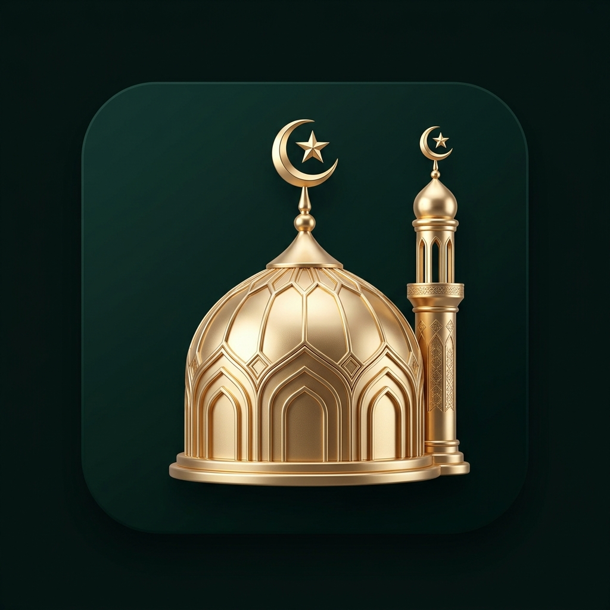

# Noor-e-Hidayah — নূর-ই-হিদায়াহ

**Your Complete Bilingual Islamic Lifestyle & Spiritual Companion for Android**  
*আপনার দৈনন্দিন ইবাদত, নামাজ, কুরআন, কিবলা ও ইন্টারেক্টিভ তাসবিহ-এর পরিপূর্ণ বাংলা ও ইংরেজি ইসলামিক সঙ্গী*

  
  
  

  
  &nbsp;
  

---

## 🌐 Official Download Links | অফিসিয়াল ডাউনলোড লিংক

Both links below **automatically point to the newest release** whenever a new version is published—no manual link updates required:

- **Official APK Landing Website (অফিসিয়াল ওয়েবসাইট):** [https://stupidboytanvir-droid.github.io/Noor-E-Hidaya/](https://stupidboytanvir-droid.github.io/Noor-E-Hidaya/)
- **Direct Latest APK Release (সর্বশেষ APK রিলিজ):** [https://github.com/stupidboytanvir-droid/Noor-E-Hidaya/releases/latest](https://github.com/stupidboytanvir-droid/Noor-E-Hidaya/releases/latest)

---

## 📿 7-Model Interactive Tasbih Studio | ৭-মডেল ইন্টারেক্টিভ তাসবিহ স্টুডিও

Built natively on **60 FPS Jetpack Compose Canvas** with real-time physics, subtle haptic & audio feedback, **Dual Atmosphere Mode** (*Signature Spiritual Theme* or your *Custom Theme Studio* palette), and **Shareable 1080×1350 Completion Reward Cards**.

> **Smart Dhikr-to-Model Auto-Sync (অটো মডেল সিঙ্ক — Default ON):** Selecting any authentic Quran or Hadith Dhikr automatically switches to its companion model below. Prefer one favorite design? Tap **Lock Model (সব জিকিরে রাখুন)** inside the Model Picker to keep a single model across all Dhikrs.

| # | Model (English & বাংলা) | Auto-Synced Dhikr | Authentic Source | Interactive Physics & Visuals |
| :-: | :--- | :--- | :--- | :--- |
| **1** | **Classic Tasbih** ক্লাসিক তাসবিহ | General & Custom User Dhikrs | General Dhikr | Tactile 3D continuous rolling bead chain with click acoustics & round tracker |
| **2** | **Soften Your Heart** হৃদয় নরম করার তাসবিহ | **Istighfar** (`أَسْتَغْفِرُ اللَّهَ` — 100) | Quran & Sunnah | Left-to-center bead strand with tip-detaching light droplets & 42-shard 3D stone-heart mosaic that sheds into a glowing heart |
| **3** | **Three-Jar Tasbih** তিন তাসবিহ জার | **Tasbih-e-Fatimah** SubhanAllah 33 + Alhamdulillah 33 + Allahu Akbar 34 = 100 | *Sahih Muslim* | Starry midnight sky, pivoting glass guide rail & 3 translucent mason jars with color-coded beads and 2D gravity stacking |
| **4** | **Garden of Jannah** জান্নাতের বাগান | `سُبْحَانَ اللَّهِ الْعَظِيمِ وَبِحَمْدِهِ` SubhanAllahil Azeem wa bihamdihi | *Jami' at-Tirmidhi 3464* | Emerald-gold seeds of light grow a swaying 5-stage date-palm tree with ripening golden dates & paradise fireflies |
| **5** | **Scales of Mizan** মীযানের পাল্লা | `سُبْحَانَ اللَّهِ وَبِحَمْدِهِ` & `لَا إِلٰهَ إِلَّا اللَّهُ` | *Sahih al-Bukhari & Muslim* | Ornate golden balance scale with damped harmonic pendulum physics dipping heavier with glowing pearls of good deeds |
| **6** | **Lantern of Noor** নূরের ফানুস | **Durood Sharif / Salawat** (`اللَّهُمَّ صَلِّ عَلَى مُحَمَّدٍ`) | *Sahih Muslim* | Hanging Islamic brass filigree Fanoos lantern growing brighter with volumetric light halos & lattice shadows |
| **7** | **Ripples of Sakina** প্রশান্তির সরোবর | **Hasbunallah**, **Hawqala** & **Dua Yunus** | *Surah Ar-Ra'd 13:28* | Moonlit still water with simultaneous overlapping concentric ripples revealing submerged golden Quranic calligraphy |

---

## ✨ Core Features | মূল বৈশিষ্ট্যসমূহ

- **🕌 Mosque Mode (মসজিদ মোড):** Automatically switches your phone to Silent or Vibration during Salah, triggers a **15-minute Pre-Jama'at Alert**, and sends an **Auto-SMS Reply** to missed callers while you are in prayer.
- **🧭 Global Qibla Compass (গ্লোবাল কিবলা কম্পাস):** International-grade compass featuring a strictly upright center Kaaba medallion, one-tap toggle between **Flexible Qibla Pointer** & **Classic Rotating Dial**, True North magnetic declination, ±3° green alignment lock, and Figure-8 calibration guidance.
- **🌍 Global Prayer Times & Time Zones (বিশ্বব্যাপী নামাজের সময় ও টাইম জোন):** Automatic GPS or manual worldwide city/time-zone detection with accurate Islamic calculation methods, next-prayer countdown, and Sehri/Iftar schedules.
- **📖 Al-Quran, Du'a, Ruqyah, Daily Hadith & AI Nasihah (আল-কুরআন, দোয়া, রুকইয়াহ, হাদিস ও এআই নসিহাহ):** Clean bilingual Quran reading experience with bookmarks, authentic Hisnul Muslim Du'as & Ruqyah collection, Daily Hadith reminders, and AI-assisted Islamic reflection (*AI Nasihah*).
- **💰 Dynamic Currency Loan Tracker (হাওলাত / লোন ট্র্যাকার):** Location-aware automatic currency detection (BDT `৳`, USD `$`, SAR `﷼`, GBP `£`, EUR `€`, and more) for tracking personal loans (*Hawlat*), repayments, and balances cleanly.
- **🎨 Ultra-Granular Custom Theme Studio (কাস্টম থিম স্টুডিও):** Customize **41 individual UI color tokens**—app surfaces, section cards, every text hierarchy, borders, icons, and subtle Islamic geometric/calligraphy watermarks—with Live Preview, RGB/HEX picker, and cloud-synced saved theme profiles.
- **🔄 In-App Auto-Updater (ইন-অ্যাপ অটো-আপডেটার):** Detects newly published GitHub Releases directly inside the app and handles seamless one-tap APK download and update installation.
- **🌐 Full Bangla & English Support (সম্পূর্ণ বাংলা ও ইংরেজি):** Instant bilingual switching across every screen, prayer alert, Tasbih model, and spiritual insight.

---

## 📲 How to Install the APK (4 Easy Steps) | APK ইনস্টল করার সহজ ৪টি ধাপ

1. **Download the Latest APK (সর্বশেষ APK ডাউনলোড করুন):**  
   Open the [Official Website](https://stupidboytanvir-droid.github.io/Noor-E-Hidaya/) or [GitHub Latest Release](https://github.com/stupidboytanvir-droid/Noor-E-Hidaya/releases/latest) and tap **Download Latest APK** (`Noor-e-Hidayah-v*.apk`).
2. **Open the Downloaded File (ডাউনলোড করা ফাইলটি খুলুন):**  
   Tap the completed download notification or locate the `.apk` file inside your phone's **Downloads** folder.
3. **Allow Installation Permission (ইনস্টলেশন অনুমতি দিন):**  
   If Android prompts you, tap **Settings → Allow from this source** (*এই উৎস থেকে অ্যাপ ইনস্টল করার অনুমতি দিন*) for your browser or file manager, then go back.
4. **Install & Enjoy Automatic Updates (ইনস্টল করুন ও অটো-আপডেট পান):**  
   Tap **Install** (*ইনস্টল*) and open **Noor-e-Hidayah**. Future versions will notify and update automatically through the built-in **In-App Auto-Updater**.

---

**Made with care for the Ummah • নূর-ই-হিদায়াহ**  
[Official Website](https://stupidboytanvir-droid.github.io/Noor-E-Hidaya/) • [Latest Release](https://github.com/stupidboytanvir-droid/Noor-E-Hidaya/releases/latest) • [All Releases](https://github.com/stupidboytanvir-droid/Noor-E-Hidaya/releases)

